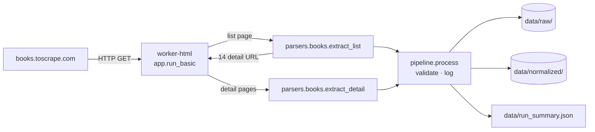
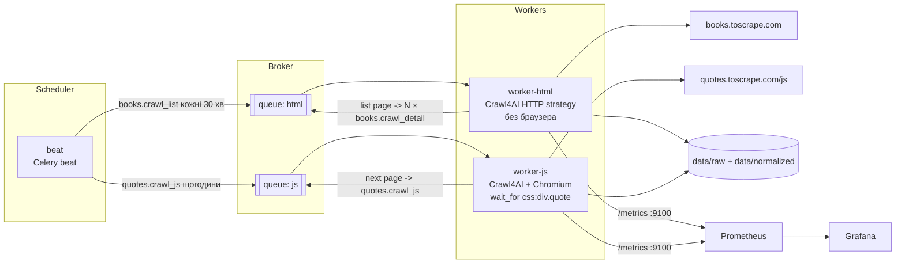
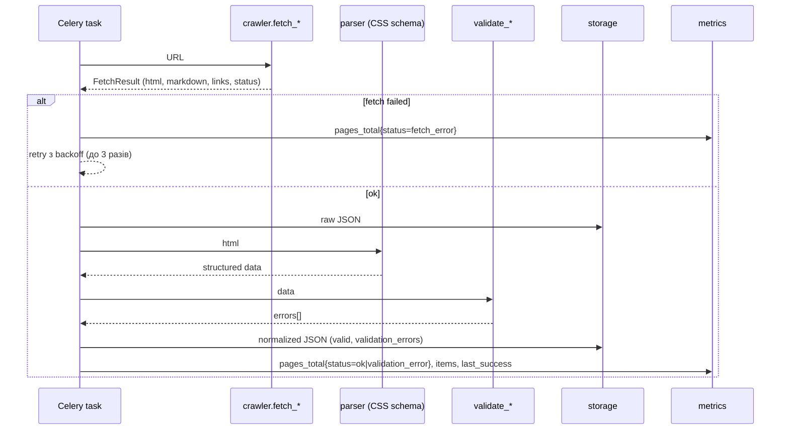

# Архітектура

## Basic

Один контейнер, один прогін, без брокера. Логіку обробки сторінки (`pipeline.process`) повторно використовує advanced-рівень.

## Advanced

## Потік однієї сторінки

## Рішення і чому

| Рішення | Причина |
|---|---|
| Дві черги `html` і `js` | браузерні задачі в 10–50 разів дорожчі; окрема черга не дає їм загальмувати дешевий HTML-збір і дозволяє масштабувати воркери незалежно |
| list і detail — окремі таски | збій однієї книжки не перезапускає весь каталог; retry точковий |
| Два Docker-таргети (`html`, `js`) | образ `worker-html` не тягне Chromium (~400 MB) |
| `-P solo` + один `/metrics` на контейнер | прості метрики без multiprocess-режиму prometheus_client; масштабування — через `--scale` |
| `task_acks_late` + `prefetch=1` | таск не губиться, якщо воркер упав посеред crawl |
| Невалідний запис зберігається з `valid=false` | зміна DOM видно в даних і метриках, а не мовчки зникає |
| Атомарний запис JSON (tmp + rename) | читач ніколи не бачить напівзаписаний файл |
